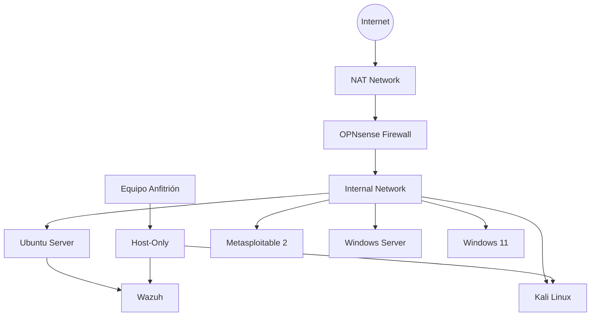

# Home-lab

## Objectivo
Construir un laboratorio virtual para practicar redes, administración de sistemas y monitorización de securidad

## Arquitectura

## Entorno
- Hypervisor: [VirtualBox]
- OPNsense []: []
- Ubuntu Server [24.10]: []
- Kali Linux []: []
- Wazuh [4.14]: []
- Windows 11 []: []
